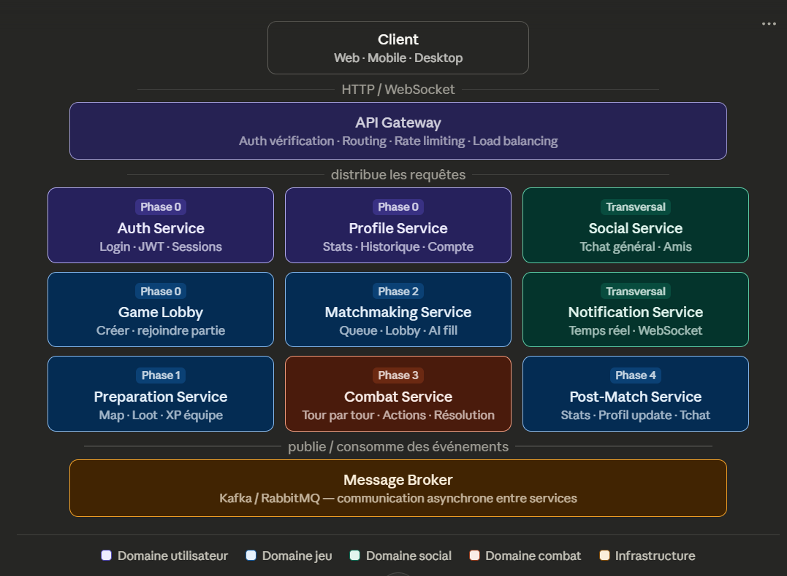

*This project has been created as part of the 42 curriculum by Dbajeux,Agaland,Bertrmar,Kprist,Stempels*

---
## Workfow

[](https://github.com/sitempels/ft_transcendence/actions/workflows/update_architecture_diagram.yml)

# ft_transcendence

## Table of Contents

1. [Description](#description)
2. [Team Information](#team-information)
3. [Project Management](#project-management)
4. [Technical Stack](#technical-stack)
5. [Project Structure](#project-structure)
6. [Docker Architecture](#docker-architecture)
7. [Database Schema](#database-schema)
8. [Features List](#features-list)
9. [Modules](#modules)
10. [Individual Contributions](#individual-contributions)
11. [Instructions](#instructions)
12. [Resources](#resources)

---

## Description

**ft_tranceandance** is a real-time multiplayer web game inspired by Pokémon and Team Fight Tactics (TFT). Players build a team of monsters, explore a map, collect loot, and battle other players in turn-based combat — all directly in the browser.

## Architecture


### Key Features

- **Lobby & Social** — friends system, general chat, group invitations
- **Map Exploration** — choose a map by upvote, collect loot, gain XP, evolve your team
- **Turn-Based Combat** — real-time multiplayer battles with attack, item use, and monster switching
- **Matchmaking** — automated queue with AI fill if a player is missing
- **Post-Match** — statistics update, match history, end-of-game chat
- **Microservices Architecture** — independent, scalable services communicating via a message broker
- **Progressive Web App** — installable with offline support

### Game Flow Overview

```
Phase 0 — Launch       →   Login, profile, lobby, social features
Phase 1 — Preparation  →   Map selection, starter pick, exploration, loot, XP
Phase 2 — Matchmaking  →   Queue, lobby creation, AI fill, team lock
Phase 3 — Combat       →   Turn-based battle until one side has no monsters left
Phase 4 — Post-Match   →   Stats calculation, profile update, end-game chat
```

---

## Team Information

| Member | Role(s) | Responsibilities |
|--------|---------|-----------------|
| [Member 1] | Product Owner / Developer | Backlog management, feature prioritization, [assigned services] |
| [Member 2] | Project Manager / Developer | Sprint planning, meeting facilitation, [assigned services] |
| [Member 3] | Tech Lead / Developer | Architecture decisions, code review, [assigned services] |
| [Member 4] | Developer | [Assigned features/services] |
| [Member 5] | Developer | [Assigned features/services] |

> ℹ️ Individual assignments will be updated as the project progresses.

---

## Project Management

### Methodology

The team follows an **Agile Scrum** approach:

- Work is split into **sprints**, each scoped between two team meetings
- Tasks are prioritized at the start of each sprint to ensure continuous progress and avoid delays
- Roles are assigned to simulate a professional environment: **Product Owner**, **Project Manager**, and **Tech Lead**

### Meetings

- **Frequency**: 2 to 4 times per month, depending on the complexity of ongoing tasks
- **Purpose**: sprint reviews, planning, unblocking issues, and alignment

### Tools

| Tool | Usage |
|------|-------|
| **GitHub** | Version control, code review, issue tracking |
| **[Trello / GitHub Projects / Notion — TBD]** | Task board and sprint tracking |

### Communication Channels

| Channel | Usage |
|---------|-------|
| **Slack** | Day-to-day team communication |
| **Discord** | Documentation sharing and remote collaboration |
| **GitHub** | Pull requests, code reviews, project tracking |

---

## Technical Stack

### Frontend

| Technology | Justification |
|------------|--------------|
| [Framework — TBD] | [e.g., React / Vue / Svelte — chosen for component reusability and ecosystem] |
| Custom Design System | 10+ reusable components, consistent color palette, typography, and icons |
| PWA (Progressive Web App) | Offline support, installability, improved mobile experience |

### Backend

| Technology | Justification |
|------------|--------------|
| [Framework — TBD] | [e.g., NestJS / FastAPI / Django — chosen for...] |
| Microservices Architecture | Separation of concerns, independent scalability per domain |
| WebSockets | Real-time features: combat updates, notifications, chat |
| API Gateway | Single entry point — JWT validation, routing, rate limiting |
| Kafka / RabbitMQ | Async communication between services (e.g., combat result → post-match trigger) |

### Database

| Technology | Justification |
|------------|--------------|
| [DB — TBD] | [e.g., PostgreSQL — relational model fits user/game data structure] |
| ORM | [e.g., Prisma / TypeORM / SQLAlchemy] — simplifies queries and schema management |

### Infrastructure & DevOps

| Technology | Usage |
|------------|-------|
| Docker / Docker Compose | Containerization of all microservices |
| ELK Stack (Elasticsearch, Logstash, Kibana) | Centralized log management and monitoring |

---

## Project Structure

```
transcendance/
│
├── docker-compose.yml          # Orchestrates all services
├── .env                        # Environment variables (never commit this)
├── .gitignore
│
├── base/                       # Shared base Docker image
│   └── Dockerfile              # All microservice Dockerfiles inherit from this
│
├── services/                   # All microservices
│   │
│   ├── nginx/                  # Reverse proxy — single entry point for all traffic
│   │   ├── Dockerfile
│   │   └── nginx.conf
│   │
│   ├── auth/                   # Authentication service (JWT, sessions)
│   │   ├── Dockerfile          # FROM transcendance-base
│   │   ├── src/                # Service source code
│   │   └── .dockerignore
│   │
│   ├── api/                    # Main API service
│   │   ├── Dockerfile          # FROM transcendance-base
│   │   ├── src/
│   │   └── .dockerignore
│   │
│   └── game/                   # Game logic service
│       ├── Dockerfile          # FROM transcendance-base
│       ├── src/
│       └── .dockerignore
│
└── volumes/                    # Persistent data (never commit this)
    ├── postgres/               # Database files
    └── redis/                  # Cache files
```

### Key Rules

- **One microservice = one autonomous folder.** Deleting `services/auth/` must not break anything else.
- **Global files live at the root.** `docker-compose.yml`, `.env`, `.gitignore` concern the whole project.
- **`volumes/` and `.env` are never committed to Git** — they contain sensitive data and are auto-generated.

---

## Docker Architecture

### Concept

All services share a common **base Docker image** (`transcendance-base`). Each microservice Dockerfile starts with `FROM transcendance-base` and only adds what it specifically needs (runtime, dependencies, source code).

```
base/Dockerfile          →  builds image  transcendance-base
                                  ↑
                    FROM transcendance-base
                    ┌─────────────┼─────────────┐
         services/auth/    services/api/    services/game/
         Dockerfile         Dockerfile       Dockerfile
```

### Base Image — `base/Dockerfile`

The base image provides a minimal, shared foundation for all microservices.

```dockerfile
# Image de base partagée par tous les microservices de Transcendance.
# Chaque service commence son Dockerfile avec : FROM transcendance-base

# OS de base — Debian slim = version allégée sans outils inutiles (~30MB)
FROM debian:12-slim

# Métadonnées de l'image (identification, documentation)
LABEL   org.opencontainers.image.title="transcendance-base" \
        org.opencontainers.image.description="Base image for all Transcendance microservices"

# TZ              : fuseau horaire pour les logs
# DEBIAN_FRONTEND : empêche apt de poser des questions interactives pendant le build
ENV TZ=Europe/Brussels \
    DEBIAN_FRONTEND=noninteractive

# Installation des outils système communs à tous les services
# --no-install-recommends : installe uniquement le strict nécessaire (image plus légère)
RUN apt-get update && apt-get install -y --no-install-recommends \
      tzdata \          # données des fuseaux horaires (requis pour TZ)
      ca-certificates \ # certificats SSL/TLS pour les requêtes HTTPS
      curl \            # requêtes HTTP (debug réseau, healthchecks)
      bash \            # shell complet (debian utilise sh par défaut)
      dumb-init \       # gestionnaire PID 1 — arrêt propre des containers
    && apt-get clean \                    # vide le cache apt
    && rm -rf /var/lib/apt/lists/*        # supprime les listes de paquets inutiles

# dumb-init devient le PID 1 du container.
# Il reçoit les signaux Docker (SIGTERM...) et les transmet proprement à l'application.
# Le "--" sépare les arguments de dumb-init de la commande du service.
ENTRYPOINT ["/usr/bin/dumb-init", "--"]
```

### What Each Tool Does

| Tool | Purpose |
|------|---------|
| `debian:12-slim` | Lightweight OS base (~30MB) |
| `tzdata` | Timezone data — required for `TZ=Europe/Brussels` to work |
| `ca-certificates` | SSL/TLS certificates for outbound HTTPS requests |
| `curl` | HTTP requests — used for healthchecks and network debugging |
| `bash` | Full shell (Debian defaults to `sh`, which is too limited) |
| `dumb-init` | PID 1 manager — ensures clean container shutdown on `docker stop` |

### Building the Base Image

The base image must be built before any service. This will be handled automatically by `docker-compose`, but can also be done manually:

```bash
docker build -t transcendance-base ./base
```

---

## Database Schema

> ⚠️ Schema is a work in progress — will be updated as services are implemented.

### Planned Tables / Collections

```
users
  - id, username, email, password_hash, avatar_url, created_at

profiles
  - id, user_id (FK), wins, losses, rank, level, xp

matches
  - id, started_at, ended_at, map_id, mode

match_participants
  - id, match_id (FK), user_id (FK), result (win/loss), team_snapshot

friendships
  - id, requester_id (FK), receiver_id (FK), status (pending/accepted/blocked)

messages
  - id, sender_id (FK), channel, content, sent_at

monsters
  - id, name, base_stats, evolution_chain

items
  - id, name, effect_type, value
```

### Relationships

- A **user** has one **profile**
- A **match** has many **participants** (users)
- A **user** can have many **friendships** and **messages**
- A **team** is composed of **monsters**, each optionally holding **items**

---

## Features List

| Feature | Description | Team Member(s) |
|---------|-------------|----------------|
  Major: Use a framework for both the frontend and backend.
◦ Use a frontend framework (React, Vue, Angular, Svelte, etc.).
◦ Use a backend framework (Express, NestJS, Django, Flask, Ruby on Rails,
etc.).
◦ Full-stack frameworks (Next.js, Nuxt.js, SvelteKit) count as both if you use
both their frontend and backend capabilities

Major: Implement real-time features using WebSockets or similar technology.

Minor: Use an ORM for the database.

Minor: Custom-made design system with reusable components, including a proper
color palette, typography, and icons (minimum: 10 reusable components).

Minor: Support for additional browsers.

Minor: Implement remote authentication with OAuth 2.0 (Google, GitHub, 42,
etc.).

Major: Introduce an AI Opponent for games.

Major: Implement a complete web-based game where users can play against each
other.

Major: Multiplayer game (more than two players).
◦ Support for three or more players simultaneously.
◦ Fair gameplay mechanics for all participants.
◦ Proper synchronization across all clients.

Minor: Game customization options

 Major: Backend as microservices

 Major swarm 
 major godot game engine  a check 
 
---

## Modules

### Point System: Major = 2 pts · Minor = 1 pt

| # | Module | Type | Points | Justification | Member(s) |
|---|--------|------|--------|---------------|-----------|
| 1 | Framework for frontend + backend | Major | 2 | Consistency and scalability across the stack | TBD |
| 2 | Real-time features (WebSockets) | Major | 2 | Required for live combat, chat, and notifications | TBD |
| 3 | User interaction (chat, profiles, friends) | Major | 2 | Core social experience of the platform | TBD |
| 4 | Public secured API | Major | 2 | External access and integration capability | TBD |
| 5 | WCAG 2.1 AA Accessibility | Major | 2 | Inclusion and regulatory compliance | TBD |
| 6 | Standard user management & auth | Major | 2 | Foundation of the entire application | TBD |
| 7 | AI Opponent | Major | 2 | Enables solo play and fills incomplete lobbies | TBD |
| 8 | Complete web-based game (PvP) | Major | 2 | Core deliverable of the project | TBD |
| 9 | Remote players (real-time multiplayer) | Major | 2 | Central gameplay experience | TBD |
| 10 | Multiplayer (3+ players) | Major | 2 | TFT-style multi-team format | TBD |
| 11 | Second game + history + matchmaking | Major | 2 | Extends the platform's game offering | TBD |
| 12 | ELK log management | Major | 2 | Production-grade monitoring and debugging | TBD |
| 13 | Backend as microservices | Major | 2 | Scalability, fault isolation, independent deployment | TBD |
| 14 | ORM for database | Minor | 1 | Safer queries, easier migrations | TBD |
| 15 | PWA with offline support | Minor | 1 | Better UX on mobile and poor connections | TBD |
| 16 | Custom design system (≥ 10 components) | Minor | 1 | Consistent UI and faster frontend development | TBD |
| 17 | Multi-browser support | Minor | 1 | Broader accessibility across user environments | TBD |
| 18 | Game statistics & match history | Minor | 1 | Player progression and engagement | TBD |
| 19 | User activity analytics dashboard | Minor | 1 | Insights for both players and administrators | TBD |
| 20 | Advanced chat features | Minor | 1 | Richer social experience | TBD |
| 21 | Tournament system | Minor | 1 | Competitive layer on top of the base game | TBD |
| 22 | Game customization options | Minor | 1 | Replayability and player agency | TBD |
| 23 | Gamification system | Minor | 1 | Long-term player retention | TBD |
| 24 | Spectator mode | Minor | 1 | Community and learning tool | TBD |
| 25 | GDPR compliance | Minor | 1 | Legal requirement for EU users | TBD |

**Total: 38 points** — a final selection and prioritization will be made during sprint planning.

---

## Individual Contributions

> ⚠️ This section will be filled in progressively as the project advances.

### [Member 1] — Product Owner / Developer
- Responsibilities: TBD
- Features implemented: TBD
- Challenges: TBD

### [Member 2] — Project Manager / Developer
- Responsibilities: TBD
- Features implemented: TBD
- Challenges: TBD

### [Member 3] — Tech Lead / Developer
- Responsibilities: TBD
- Features implemented: TBD
- Challenges: TBD

### [Member 4] — Developer
- Responsibilities: TBD
- Features implemented: TBD
- Challenges: TBD

### [Member 5] — Developer
- Responsibilities: TBD
- Features implemented: TBD
- Challenges: TBD

---

## Instructions

### Prerequisites

Before running the project, make sure you have the following installed:

| Tool | Version |
|------|---------|
| Docker | ≥ 24.x |
| Docker Compose | ≥ 2.x |
| Git | Latest stable |

### Environment Setup

1. Clone the repository:
   ```bash
   git clone https://github.com/[org]/ft_tranceandance.git
   cd ft_tranceandance
   ```

2. Copy the environment template and configure it:
   ```bash
   cp .env.example .env
   ```

3. Fill in the required variables in `.env`:
   ```env
   # Auth
   JWT_SECRET=your_jwt_secret

   # Database
   DB_HOST=postgres
   DB_PORT=5432
   DB_NAME=tranceandance
   DB_USER=your_user
   DB_PASSWORD=your_password

   # API
   API_KEY=your_api_key
   ```

### Running the Project

```bash
# Build the base image first
docker build -t transcendance-base ./base

# Start all services
docker compose up --build

# Stop all services
docker compose down
```

> The application will be available at `http://localhost:[PORT — TBD]`

### Running Tests

```bash
# TBD — test commands will be added as the project progresses
```

---

## Resources

### Documentation

- [WebSocket API — MDN](https://developer.mozilla.org/en-US/docs/Web/API/WebSocket)
- [Progressive Web Apps — web.dev](https://web.dev/progressive-web-apps/)
- [WCAG 2.1 Guidelines](https://www.w3.org/TR/WCAG21/)
- [Elasticsearch Documentation](https://www.elastic.co/guide/index.html)
- [Docker Documentation](https://docs.docker.com/)
- [Kafka Documentation](https://kafka.apache.org/documentation/)

### Articles & Tutorials

- [Microservices Architecture Patterns](https://microservices.io/patterns/)
- [JWT Best Practices](https://auth0.com/blog/a-look-at-the-latest-draft-for-jwt-bcp/)
- [Designing a Turn-Based Game Engine](https://www.gamedev.net/) *(to be refined)*


## Microservice Overview

