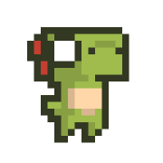
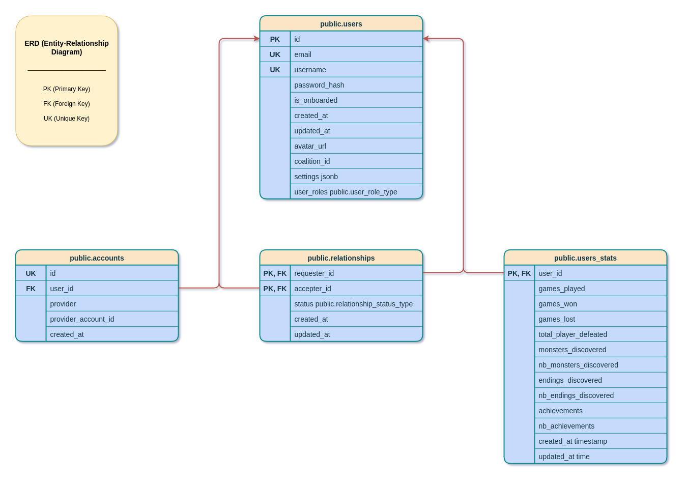
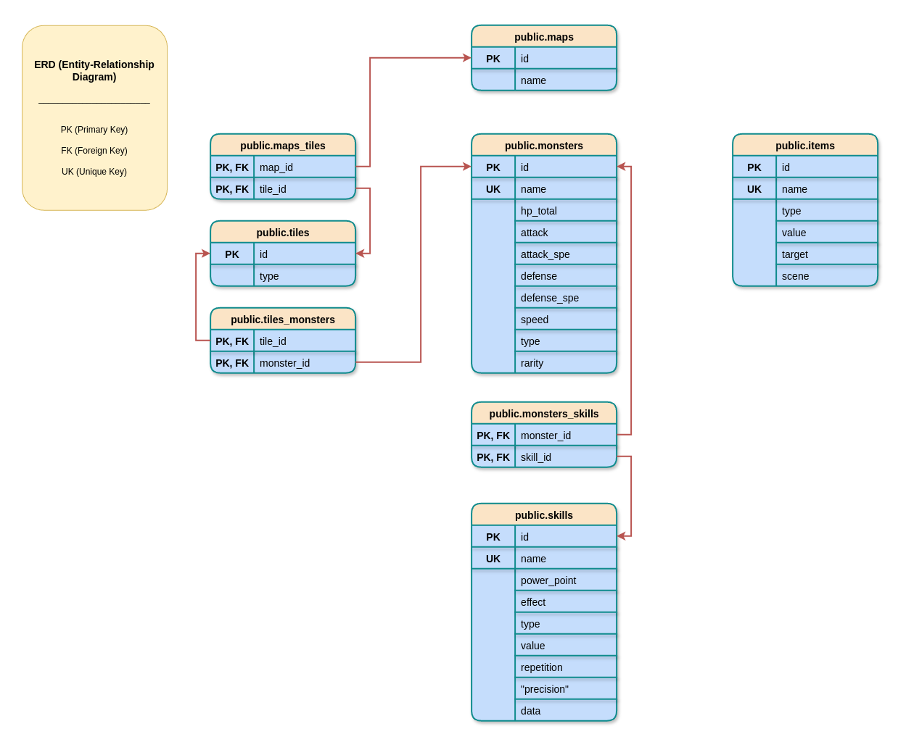
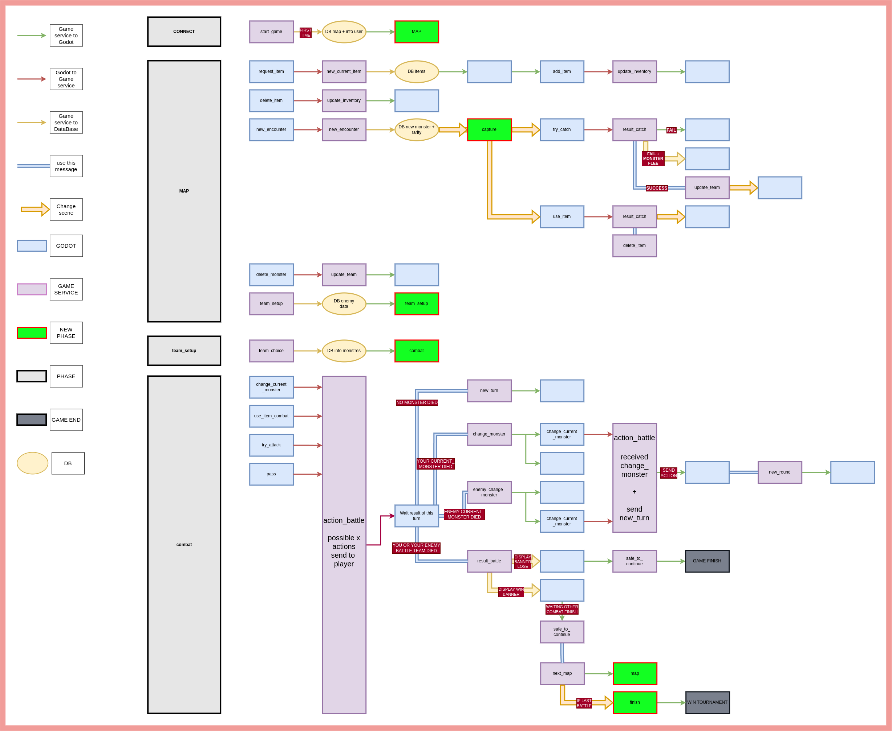

*This project has been created as part of the 42 curriculum by Bertrmar, Stempels, Dbajeux, Kprist, Agaland.*
 

# ft_transcendence - Free Assets 
 
## Table of Contents

1. [Description](#description)
2. [Team Information](#team-information)
3. [Individual Contributions](#individual-contributions)
4. [Project Management](#project-management)
5. [Technical Stack](#technical-stack)
6. [Database Schema](#database-schema)
7. [Game Workflow](#game-workflow)
8. [Features List](#features-list)
9. [Modules](#modules)
10. [Instructions](#instructions)
11. [Ideas for Future Evolution](#ideas-for-future-evolution)
12. [Resources](#resources)

---
 
## Description

**ft_transcendence** is a sandbox project built by a team of five, with one challenge in mind: *if we already know a technology, we're not allowed to use it.* The goal was to design and ship a full multiplayer web game in a professional-style working environment with real deadlines, task ownership, and cross-team coordination while every team member picked up a new stack along the way.
 
Concretely, the project combines:
- A custom **multiplayer game** built with the **Godot** engine, featuring monsters, skills, maps, and an AI opponent to fill unbalanced lobbies.
- A **web platform** (React frontend, NestJS backend) handling authentication, user profiles, friends, real-time chat, notifications, and lobby/matchmaking.
- A **self-hosted infrastructure** running on **Docker Swarm**, spread across multiple school computers, with a full monitoring and logging stack.
### Key Features
 
- 🔐 Authentication via the 42 OAuth API + classic account creation, secured with JWT
- 👥 Friends system, invitations, and real-time notifications
- 💬 Real-time chat
- 🎮 Custom multiplayer game (Godot) with an AI opponent, monsters, skills, and explorable maps, inventory system
- 🕹️ Lobby system backed by Redis
- 🎨 Custom, responsive frontend (React + TypeScript + Tailwind CSS)
- 🐳 Distributed deployment via Docker Swarm across multiple nodes
---
 
## Team Information
 
| Login | Role | Responsibilities |
|---|---|---|
| **bertrmar** | Product Owner | Defines and prioritizes tasks according to the project's requirements, with respect for the "no known tech" rule as the top priority; keeps the team on track for deadlines. |
| **dbajeux** | Project Manager | Organizes the project's progress, leads and schedules meetings, and follows up on each member's advancement. |
| **kprist** | Full-Stack Developer | Owns the frontend, the user-facing backend services (auth, chat), and the database setup. |
| **stempels** | Infrastructure Engineer | Designs and operates the self-hosted infrastructure: VM provisioning, Docker Swarm orchestration, networking, monitoring and logging. |
| **agaland**  | Developer  Game/Backend Liaison | Handles the WebSocket bridge between the Godot game client and the backend: sends/receives game events, manages connection and disconnection. |

### Detailed Responsibilities
 
**bertrmar: Product Owner**
Chooses the priorities and drives task execution according to the subject's requirements for this project, that primarily meant respecting the "no known technology" rule and hitting deadlines. Worked on the game itself, the networking layer between the game client and the game service, the game service, and Redis.
*Main challenge:* figuring out what to prioritize, and when solved with a weekly review meeting, plus getting a custom game engine (Godot) to talk to a custom server, which required a lot of documentation and video research before the first successful connection test, and finding/creating visual assets for the game with the help of AI tools.
 
**dbajeux: Project Manager**
Organizes the project's advancement and leads meetings to keep the team moving forward. Beyond PM duties, worked hands-on on the game's exploration mode in Godot, the level design conception, and the implementation of in-game skins. Also built the lobby backend, AI system, the README, and contributed to some of the frontend design. Main challenge: a difficult merge conflict between the game's core business logic and the AI bot logic resolved through close pair-programming with Agaland
 
**kprist: Full-Stack Developer**
Primarily responsible for the frontend, along with the backend logic for user management, the chat service, and setting up both databases. Worked on authentication and account creation, 42 OAuth, chat, the friends system, the notification/invitation system, user settings, and JWT handling.
*Main challenge:* the project initially used 42 OAuth as the only authentication method; retrofitting classic email/password accounts on top of that turned out to be very difficult. The user service was ultimately rebuilt from scratch, along with the user database schema.
 
**stempels: Infrastructure Engineer**
Built and maintained a stable, reproducible environment for the project (VMs) and made a multi-node Docker Swarm deployment possible on the school's computers, ensuring the swarm had enough compute power and remained resilient.
*Main challenge:* not explicitly detailed infrastructure work centered on building a repeatable `make`-driven provisioning flow for both leader and worker nodes (see [Instructions](#instructions)).
 
**agaland: Game Backend Developer**
Owns the backend lifecycle of a match from the Godot client's WebSocket connection to the end of the tournament including the Game Gateway, the Game Service (syncing game phases and player state across map, team selection, and combat), matchmaking, and combat rooms.
*Main challenge:* integrating the AI logic into the existing Game Service without breaking the flow, solved through a line-by-line code review and tightly-scoped tasks with regular feedback. Keeping players synchronized during combat also took a lot of back-and-forth between Godot and the backend, debugged via exports and console logs.

---

## Individual Contributions
 
| Scope | Team | Main Features |
|---|---|---|
| **Infrastructure / Docker** | stempels | Docker Swarm deployment across multiple school computers, VM provisioning, container-to-container networking, monitoring & logging stack |
| **Frontend** | kprist | User management UI, friends UI, chat UI, general design (React, HTML, Tailwind) |
| **Backend (User & Chat Services)** | kprist | Backend logic for user management, authentication (42 OAuth + classic accounts, JWT), the chat service, friends/social system, and notifications |
| **Game** | bertrmar, dbajeux, agaland | Multiplayer mode, AI opponent, map exploration, game visuals/assets, core gameplay/design |
| **Game ↔ Web Liaison** | agaland, dbajeux, bertrmar | WebSocket bridge between Godot and the backend, lobby management (Redis), connection/disconnection handling |
| **Database** | kprist, bertrmar | Design and setup of both databases; storage and retrieval logic for user data and game/stats data |
 
## Project Management
 
- **Task distribution:** work was split first by feature, then by module, and finally refined at the individual-requirement level as the project progressed.
- **Meetings:** the team started with one meeting per week, and switched to a daily meeting during the final crunch period.
- **Project management tooling:** GitHub (repository + version control) was the main tool. The team initially intended to also use GitHub Issues more formally, but in practice quickly fell back to coordinating through Slack alongside Git for versioning.
- **Communication:** Slack was used throughout the project as the main communication channel, alongside live/in-person meetings.
---
### Team Wellbeing & Cohesion

Beyond task tracking, the team made a deliberate effort to protect group cohesion throughout the project.

- **Check-in at the start of every meeting:** each meeting opened with a quick round where any team member could raise concerns, friction points, or discomfort within the group, before moving on to the technical agenda. This was treated as a fixed part of the meeting structure, not an afterthought.
- **Why:** with five people learning mostly unfamiliar technologies under real deadlines, tension and frustration were expected. Surfacing it early, on a regular cadence, was intended to prevent small frictions from turning into larger conflicts and to keep communication open across the team.

## Technical Stack
 
### Frontend
- **React** with **TypeScript**
- **Tailwind CSS** for styling
- **Godot** (engine) for the game client itself
### Backend
- **NestJS** (TypeScript)
- **Redis**  in-memory store for active game rooms, lobby state (players per room), and general key-value caching
### Database
- **PostgreSQL**, split across two databases (`users_db` and `game_db`)
- Chosen for its performance and its native support for storing JSON/JSONB data (used for flexible fields such as user settings)
### Infrastructure & Deployment
- **Docker** & **Docker Swarm**  containerization and multi-node orchestration
- **Docker Bake**  streamlined builds for a project with many images
- **Tailscale / Headscale**  self-hosted VPN for secure inter-node communication
- **Nginx**  reverse proxy, HTTP/HTTPS termination
- **OpenSSL**  self-signed certificates
- **Private Docker Registry**  self-hosted image storage
- **Prometheus**, **Loki**, **Grafana**, **Alloy**  metrics collection, log aggregation, and unified dashboards
- **Bash / Makefile / YAML**  scripting, orchestration, and configuration
### Other Key Technologies
- **WebSocket**  real-time communication between the game client, the backend, and connected players
- **TypeORM**  ORM layer for NestJS/PostgreSQL
- **42 OAuth API** + **JWT**  authentication
### Technical Choices  Justification
 
| Choice | Why |
|---|---|
| Redis | In-memory data store, ideal for the fast, ephemeral reads/writes needed to track active rooms and lobby membership in real time, without the overhead of a relational DB for transient state. |
| Docker Swarm | The team was constrained by the limited resources of individual school computers, so workloads needed to be distributed and orchestrated across several machines. |
| WebSocket | Required for low-latency, bidirectional communication between players in a real-time multiplayer game. |
| 42 API (OAuth) | The project is built for the 42 school, so authenticating through the school's own identity provider was a natural fit. |
| Godot | A game engine that is powerful enough for the project's needs without being overly complex  approachable for a team without prior game-dev experience, yet capable enough for a "real" game, and it was selected after a testing/comparison phase against other engines. |
| React & NestJS | Both are widely adopted in the web ecosystem, meaning abundant documentation and community support  valuable for a team learning most of the stack from scratch. |
| PostgreSQL | Strong performance combined with native JSON/JSONB support, avoiding the need for a second, separate document store. |
 
---
 

 
## Database Schema
 
The project uses **two separate PostgreSQL databases**: `users_db` (accounts, social features, stats) and `game_db` (game content: maps, monsters, skills, items).
 
### `users_db`
 
Handles authentication, social features (friends), and player statistics.
 

 
- **`users`**  core account table (email, username, password hash, avatar, coalition, settings as JSONB, roles).
- **`accounts`**  linked auth providers per user (**One-to-Many** with `users`), supporting both classic and OAuth login.
- **`users_stats`**  gameplay statistics per user (**One-to-One** with `users`): games played/won/lost, monsters and endings discovered, achievements.
- **`relationships`**  friendships between users (**Many-to-Many** on `users`, via `requester_id` / `accepter_id`), with a `status` field (e.g. pending/accepted).
### `game_db`
 
Holds all game content: maps, tiles, monsters, skills, and items.
 

 
- **`maps`** ↔ **`tiles`**  **Many-to-Many** via `maps_tiles`.
- **`tiles`** ↔ **`monsters`**  **Many-to-Many** via `tiles_monsters`.
- **`monsters`** ↔ **`skills`**  **Many-to-Many** via `monsters_skills`.
- **`items`**  standalone table of usable objects (potions, boosts, etc.), not related to the other tables.

 
 
---

## Game Workflow

The diagram below traces the full lifecycle of a game session, from the initial WebSocket connection to the end of a match, across the three main phases: **Map**, **Team Setup**, and **Combat**. It also shows how each event flows between the Godot client, the game service, and the database.



### Phases Overview

- **Connect**  the client establishes the WebSocket connection with the game service.
- **Map**  on first connection, the map and user info are fetched from the DB. From there, players can manage their inventory (request/delete items), and trigger monster encounters, which branch into a **capture** sub-flow (try to catch, or use an item) resolving in success, failure, or a fleeing monster.
- **Team Setup**  once a monster roster is ready, players build their battle team, drawing enemy data from the DB, before moving into combat.
- **Combat**  turn-based phase (`action_battle`) where each player can change monster, use an item, attack, or pass. Results are broadcast each round (`new_round`) until a battle team is fully defeated, triggering win/lose banners, and either progressing to the next map or, on the final battle, a tournament win screen.

---
## Features List

### 🔐 Authentication & User Management

| Feature | Description | Contributor(s) |
|---|---|---|
| 42 OAuth login | Authentication via the 42 school's own OAuth 2.0 identity provider. | kprist |
| Classic account creation | Email/password signup and login, added on top of the initial OAuth-only system. | kprist |
| JWT session handling | Secures user sessions across the platform after login. | kprist |
| User profile & avatar | Dedicated profile page; users can edit their info and upload/change their avatar. | kprist |

### 👥 Social

| Feature | Description | Contributor(s) |
|---|---|---|
| Friends system | Add/remove friends and view their online status. | kprist |
| Invitations & notifications | Real-time notifications for friend requests and game invitations. | kprist |
| Real-time chat | Live messaging between users, backed by WebSocket. | kprist |

### 🎮 Game

| Feature | Description | Contributor(s) |
|---|---|---|
| Lobby & matchmaking | Redis-backed system tracking active rooms and players per room. | dbajeux (lobby backend), bertrmar (Redis integration) agaland |
| Map exploration | Explorable maps where players move around and encounter monsters. | dbajeux, bertrmar |
| Monster capture | Encounter, try-catch, and item-based capture flow, with success/fail/flee outcomes. | bertrmar, dbajeux, agaland |
| Inventory system | Request, use, and delete items collected during exploration. | bertrmar, dbajeux, agaland |
| Team setup | Players build their battle team from captured monsters before combat. | bertrmar, agaland |
| Turn-based combat | Action-based battle phase (attack, change monster, use item, pass), resolved round by round. | bertrmar, agaland |
| AI opponent | Custom AI bot that fills lobbies when not enough human players are available. | dbajeux,agaland |
| In-game skins | Cosmetic customization options for monsters/characters. | dbajeux |
| Tournament progression | Win/lose banners and map-to-map progression up to a final tournament win screen. | bertrmar, agaland |
| Godot ↔ backend bridge | WebSocket bridge sending/receiving game events, handling connect/disconnect between the Godot client and the backend. | agaland, bertrmar  |

### 🎨 Frontend

| Feature | Description | Contributor(s) |
|---|---|---|
| Responsive web UI | Full frontend built with React, TypeScript, and Tailwind CSS. | kprist |

### 🗄️ Database

| Feature | Description | Contributor(s) |
|---|---|---|
| Dual PostgreSQL setup | Two separate databases (`users_db`, `game_db`) designed and set up for social/account data vs. game content. | kprist, bertrmar |

### 🐳 Infrastructure

| Feature | Description | Contributor(s) |
|---|---|---|
| Docker Swarm deployment | Multi-node container orchestration across several school computers. | stempels |
| Monitoring & logging stack | Prometheus, Loki, Grafana, and Alloy for metrics collection, log aggregation, and dashboards. | stempels |

---

## Modules

### Standard Modules

| # | Module | Type | Points | Implementation |
|---|---|---|---|---|
| 1 | Framework (frontend + backend) | Major | 2 | NestJS (backend) + React (frontend), used from the very start of the project. |
| 2 | Real-time features (WebSockets) | Major | 2 | WebSocket bridge between Godot, the backend, and connected players; also powers live chat. |
| 3 | User interaction | Major | 2 | Friends system, invitations, real-time chat, notifications. |
| 4 | ORM | Minor | 1 | TypeORM integrated with NestJS across both databases. |
| 5 | Support for additional browsers | Minor | 1 | Manually tested on Chrome, Brave, Firefox, and Edge. |
| 6 | Standard user management & authentication | Major | 2 | Profile, avatar, friends with online status, dedicated profile page. |
| 7 | Remote authentication (OAuth 2.0) | Minor | 1 | Implemented via the 42 API. |
| 8 | AI Opponent | Major | 2 | Custom AI implemented in the backend to fill unbalanced lobbies. |
| 9 | Web-based multiplayer game | Major | 2 | Built from scratch using Godot; players compete against each other. |
| 10 | Multiplayer game (3+ players) | Major | 2 | Built with Godot, WebSocket, and Redis. |
| 11 | Game customization options | Minor | 1 | *(à préciser : power-ups, skins, maps  tu mentionnes déjà "in-game skins" ailleurs dans le README, à relier ici)* |
| 12 | Backend as microservices | Major | 2 | Structured progressively into loosely-coupled services (game, user, chat, AI). |
| 13 | Custom design system with reusable components | Minor | 1 | Built with React and Tailwind CSS, including a dedicated color palette, typography, and icon set (10+ reusable components). |

**Standard modules subtotal: 8 Major (16 pts) + 5 Minor (5 pts) = 21 points**

---

### Modules of Choice (Custom)

> Per the subject's requirements, each custom module below must justify: **why chosen**, **what technical challenge it addresses**, **how it adds value**, and **why it deserves its point status**. These will also need to be defended live during evaluation.

| Module | Type | Points | Why We Chose It | Technical Challenge | Value Added | Why This Status |
|---|---|---|---|---|---|---|
| **Custom game & site assets/graphics** | Minor | 1 | A genuine amount of graphic design work went into this project: part of the assets were created from scratch with AI assistance, complemented by the Tiny World library after a research phase. Its assets were then animated in-house and visually harmonized with our own creations. | Most assets and graphics  for the whole site plus the combat phase  were created in-house rather than sourced. | Gives the project visual coherence and a distinct identity rather than relying on generic/stock assets. | Classified as Minor the team wants to acknowledge the effort that went into it, but doesn't consider it substantial enough on its own to justify a Major module. |
| **Godot engine integration** | Major | 2 |The integration of the Godot Engine is a major component of our project. By choosing to work with a professional game development framework, we were able to benefit from a robust, well-established environment suited to the demands of quality game development. Relying on an established game engine represents a genuine added value for our project, both from a technical standpoint and in terms of the credibility of our approach. | Integrating a real, standalone game engine (not a web-native framework) into a browser-based platform, including bridging it to a custom NestJS backend over WebSocket. | Enables a genuine game-engine-grade experience (physics, scenes, rendering) inside a web product, which a JS-only game library couldn't match. | Beyond the design phase, getting up to speed with Godot required a significant time investment, both for learning the engine and for actual development work. bertrmar and dbajeux dedicated substantial development time to reach the desired final product, ensuring a result that lives up to the project's initial ambitions. |
| **Redis optimization** | Minor | 1 | Redis was chosen to persist player state and to handle room creation and management, making it easy to manipulate cached data across the different services. It also helped optimize database calls a key consideration given the performance constraints of the campus PCs | Used to optimize database load  offloading fast-changing, ephemeral state (active rooms, lobby membership) from PostgreSQL. | by avoiding round-trips to PostgreSQL for every real-time interaction (player state, combat rooms), Redis reduces perceived latency for players and lightens the database load during activity spikes  such as combat, where state changes on every turn. This kept response times stable even on the campus's limited-resource PCs | Classified as Minor since it represents a new technology the team learned for this project. Down the line, at scale, it would allow adding features such as reconnection handling but that potential isn't enough on its own to justify a Major. |
| **Docker Swarm orchestrator** | Major | 2 | The team was constrained by the limited resources of individual school computers. | Distributing and orchestrating containerized workloads across multiple physical machines reliably. | Pools compute power across nodes, making the full stack (monitoring, multiple services, DBs) viable on school hardware. | *(à compléter  insiste sur le côté "contrainte technique réelle" plutôt que choix de confort)* |
| **VM automation & sysadmin environment** | Minor | 1 | *(à compléter)* | Building a repeatable, `make`-driven provisioning flow for leader and worker nodes. | Makes onboarding/deployment reproducible across the team instead of manual, error-prone setup per machine. | *(à compléter)* |

**Custom modules subtotal: 2 Major (4 pts) + 3 Minor (3 pts) = 7 points**

---

### Total Points

| Category | Points |
|---|---|
| Standard modules | 21 |
| Modules of choice (custom) | 7 |
| **Total** | **28** |


## Instructions
 
### Prerequisites
 
- A Linux distribution (developed and tested on **Ubuntu 22.04.4 LTS**  check with `lsb_release -a`)
- **VirtualBox** (tested with version 7.0.26r168464  check with `vboxmanage --version`)
- **npm** (tested with version 10.7.0  check with `npm --version`)
- **bash** (tested with version 5.1.16(1)  check with `bash --version`)
- An **Alpine Linux** VM ISO (version 3.23.4  check with `cat /etc/alpine-release`), with `alpine-setup` already run (default options) and **Docker** installed (version 29.5.2  check with `docker --version`)
### Environment Configuration
 
Two `.env` files are required, based on the provided templates:
 
- **`root_of_project/.env_vm`**  configuration for the VM environment
- **`infra/.env_infra`**  configuration for the Swarm/infrastructure environment
If a `.env_vm` file is missing (and a `template_env_vm` exists), the `Makefile` will automatically create one and open it in `vim`  fill in every field, then save and quit (`:wq` or `:x`). The same mechanism applies to `.env_infra`.
 
**`.env_vm` variables:**
 
| Variable | Description |
|---|---|
| `BASE_DIR` | Directory containing the VM ISO |
| `BASE_IMG` | Name of the VM ISO file |
| `VM_DIR` | Directory in which the VM will be created |
| `p_root_password` | Root password for the Alpine VM's root account |
| `p_user_password` | Password for the user created by the setup script (the username is `$(USER)` from the shell running `make`) |
 
**`.env_infra` variables:**
 
- User-defined values can be anything you choose.
- API 42 values must match the credentials from your 42 API application page.
- `p_node_<login>` refers to another node that may join the swarm  replace `<login>` with that node's user login. Its value must match the `p_user_password` configured on that node.
### Running the Project
 
**As the leader node of the Docker Swarm**, from the project root:
 
```bash
make
```
 
That's the only command needed to bring up the leader node.
 
**To add another node to the swarm**, from the project root on the new machine:
 
```bash
make worker
```
 
`.env_vm` configuration works the same way as for the leader node; `.env_infra` is not used on worker nodes.
 
> A worker node is only auto-connected to the swarm if it is on the school network, running on a desktop (not a laptop), and its user's login is pre-registered in `infra/swarm_utils/config/launch_swarm`. Nodes can also be added later by running `make addnode` from the `infra` directory on the leader node.
 
### Verifying the Deployment
 
- Watch the console output  you should see a stream of setup logs.
- If nothing failed, run `docker service ls`  this should list all the running services.
- From your host machine's browser, go to `http://<machine_ip>:8080/` or `https://<machine_ip>:8443` (HTTP will redirect to HTTPS).
- Your browser will warn about an insecure/self-signed certificate  this is expected; accept the connection.
- The project's home page should load.
---

## Ideas for Future Evolution
 
These features were discussed during the project's design phase, and the architecture was often built with them in mind so they could be added later  but they couldn't be implemented in time.
 
### 🎮 Gameplay & Game Content
 
- **Starting boost**  a temporary advantage granted to players at the very beginning of a match.
- **Expanded map pool**  creating additional maps, ready to be plugged in beyond the ones currently shipped.
- **Extensible monster database**  the schema was designed so new monsters and items could be added easily, without a rework.

- **Redis-backed reconnection handling**  allowing a player to reconnect to an ongoing match after a disconnect, using state stored in Redis.

### 🗄️ Database Extensibility
 
- **Multi-provider authentication**  the tables were designed to support authentication methods other than the 42 API.
- **Custom usernames for 42 accounts**  allowing a user logged in via the 42 API to pick a username different from their 42 login.
- **Extended relationship statuses**  the `relationships` schema was designed to support additional statuses, such as "blocked".
### 🎨 Frontend
 
- **Reusable component library**  the React/Tailwind component library was built so components could be reused if the frontend needed to grow further.
### 🐳 Infrastructure & Observability
 
- **Better load balancing across containers**  improving how workloads are distributed across the swarm's nodes.
- **Deeper metrics**  making fuller use of the Grafana stack already in place.
## Resources
 
### Official Documentation
 
- [NestJS  Caching](https://docs.nestjs.com/techniques/caching)
- [NestJS](https://nestjs.com/)
- [Tailwind CSS](https://tailwindcss.com/)
- [Godot Engine Docs](https://docs.godotengine.org/)
- [Docker](https://docs.docker.com/)
- [Docker Swarm](https://docs.docker.com/engine/swarm/)
- [Docker Compose](https://docs.docker.com/compose/)
- [Docker Bake](https://docs.docker.com/build/bake/)
- [Tailscale](https://tailscale.com/docs)
- [Headscale](https://headscale.net/stable/)
- [OpenSSL](https://docs.openssl.org/)
- [Nginx](https://nginx.org/en/docs/)
- [Distribution (Docker Registry)](https://distribution.github.io/distribution/)
- [Grafana Alloy](https://grafana.com/docs/alloy/latest/)
- [Prometheus](https://prometheus.io/docs/)
- [Grafana Loki](https://grafana.com/docs/loki/latest/)
- [Grafana](https://grafana.com/docs/grafana/latest/)
- [Bash Manual](https://www.gnu.org/software/bash/manual/)
- [POSIX Shell Command Language](https://pubs.opengroup.org/onlinepubs/9699919799/utilities/V3_chap02.html)
- [GNU Make Manual](https://www.gnu.org/software/make/manual/)
- [YAML Spec 1.2.2](https://yaml.org/spec/1.2.2/)
### Tutorials & Articles
 
- Udemy  *NestJS: The Complete Developer's Guide* by Stephen Grider
- [CSS-Tricks](https://css-tricks.com/)
- YouTube  *Tailwind CSS v4 Full Course 2026 | Master Tailwind in One Hour*, by JavaScript Mastery
- [Tailwind CSS Cheat Sheet](https://nerdcave.com/tailwind-cheat-sheet)
- YouTube  *A New Approach to Game Design and User Tools with Godot* (used for map/scene creation)
### AI Usage
 
AI tools (primarily Gemini) were used throughout the project for:
 
- **Learning new technologies:** acquiring foundational knowledge of Godot and TypeScript for team members without prior experience in either.
- **Design assistance:** brainstorming and refining approaches for the Godot game and TypeScript backend/frontend code.
- **Asset creation:** generating visual assets for the game (creatures, scenes) where no suitable existing assets were available.
- **Debugging & optimization:** helping diagnose bugs, optimize code, and improve backend logging.
- **Infrastructure work:** assisting with basic YAML configuration, acting as a "rubber duck" for troubleshooting, and writing small, repetitive utility scripts.


