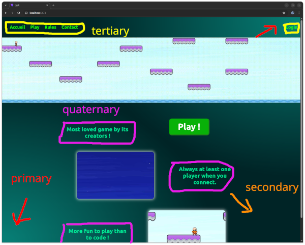

*This project has been created as part of the 42 curriculum by Dbajeux, Agaland, Bertrmar, Kprist, Stempels*
<pre align=center>
<font color=orange>
 █████   █████                              █████                      ███████████                                █████                            █████
░░███   ░░███                              ░░███                      ░░███░░░░░░█                               ░░███                            ░░███ 
 ░███    ░███   ██████  █████ ███ █████    ███████    ██████     ██    ░███   █ ░  ████████   ██████  ████████   ███████    ██████  ████████    ███████ 
 ░███████████  ███░░███░░███ ░███░░███    ░░░███░    ███░░███   ░░     ░███████   ░░███░░███ ███░░███░░███░░███ ░░░███░    ███░░███░░███░░███  ███░░███ 
 ░███░░░░░███ ░███ ░███ ░███ ░███ ░███      ░███    ░███ ░███          ░███░░░█    ░███ ░░░ ░███ ░███ ░███ ░███   ░███    ░███████  ░███ ░███ ░███ ░███ 
 ░███    ░███ ░███ ░███ ░░███████████       ░███ ███░███ ░███          ░███  ░     ░███     ░███ ░███ ░███ ░███   ░███ ███░███░░░   ░███ ░███ ░███ ░███ 
 █████   █████░░██████   ░░████░████        ░░█████ ░░██████     ██    █████       █████    ░░██████  ████ █████  ░░█████ ░░██████  ████ █████░░████████
░░░░░   ░░░░░  ░░░░░░     ░░░░ ░░░░          ░░░░░   ░░░░░░     ░░    ░░░░░       ░░░░░      ░░░░░░  ░░░░ ░░░░░    ░░░░░   ░░░░░░  ░░░░ ░░░░░  ░░░░░░░░ 

</font>
</pre>                                   

⚠️ Project is under development and is changing fast. Information in this readme might not be completly updated to the current workflow.

This part of the project concerns the frontend development and uses 3 main components.
 * **React**: a javascript/typescript library that helps generate html in a easier way.
 * **Vite**: a bundler, that "builds" the project. Vite needs Node.js to run.
 * **Node.js**: the environment/server for javascript to run.
 
 While concerning the frontend, some backend features might be used for testing features and navigation. Though, those are not meant for final production.

# 🗂️ Architecture

```bash
kprist/
│
├── node_modules/                # Modules automatically generated by npm when initializing the project. Makes node to work,
│
├── public/                      # public resources available for the user.
│
├── src/                         # Sources files  
│    ├── assets/                    # Contains assets for the website like images, video and the game.
│    │    ├──game/
│    │    └──images/
│    │
│    ├── components/                # tsx and css files for generating single webpage elements(buttons, headers...)
│    │
│    ├── context/                   # tsx files related to context (themes, variables, state...)
│    │
│    ├── pages/                     # tsx and css files for generating specific webpages
│    │
│    ├── utils/                     # tsx related to pure logic (no React or html involved)
│    │
│    ├── App.tsx                    # Client-side Router, calls the right page/components for the corresponding URL
│    ├── App.css                    # Stylesheet for App.tsx
│    │
│    ├── main.tsx                   # Typescript entrypoint. Links index.html with App.tsx
│    └── main.css                   # Stylesheet for main.tsx
│  
├── index.html                   # Html entrypoint of the webapplication
│
└── ...                         # config files for vite 

```

# 📋 Instructions
### 1. Run the server
At the root of the directory type the following command:
```sh
npm run dev [-- --host|--port|--open]
```

This will open a node server so that vite can bundle the project. 

|Flag|Action|
|--|--|
|--host| Specify Vite to listen to all networks instead of just localhost. To be used for containers.|
|--port| Specifies the port on which the server (Node.js) should listen to. Default is 5173|
|--open| Automatically opens the browser on the specified localhost:port|

### 2. Open the browser
Open any web browser on http://localhost:5173 or on the specified port.

# ⚙️ Workflow

The webapp is built as a **SPA** (Single Page Application). This means there is **only one html file** which is `index.html`. When requested, it is loaded only once and React will dynamically update the content as the user navigates.

## index.html
The index.html file contains the basic html instructions to create a basic html page. It contains two necessary lines for React to work:
```html
<div id="root"></div>
<script type="module" src="./src/main.tsx"></script>
```

The root div is the html tag that React will modify to create the whole content of the webpage. This is done via the `./src/main.tsx` script used in the second line.

## main.tsx
This file manages the configurations of webpages. It is the **main link between `index.html` and `App.tsx`**. It's used to give context (like themes or states) to the webpage.

```ts
createRoot(document.getElementById('root')!).render(
    <StrictMode>                // checks purity of functions.
        <BrowserRouter>             // allows the use of Routes for <App />
            <ThemeProvider>           // provides the theme
                <App />                 // links to App.tsx
            </ThemeProvider>
        </BrowserRouter>
    </StrictMode>,
)
```


#### StricMode
`<StricMode>` is a tool to highlight highly potential problems in the code. It **checks purity of React functions** by running them twice. A function is pure if it always return the same value for a given parameter, and neither can it directly change the value of an outside parameter.

##### BrowserRouter
It is a component of the React-router library used by App.tsx to **generate the appropriate page based on the URL**.

## App.tsx
This is basically the "**router**" for building the webpage's content. It uses the **React-router** library and will call the right React function (in pages/ directory) to generate the pages content. Because the webapp is a *SPA* it implies the use of React-router Component **`<Link to="...">`** instead of classic `<a href="...">` to navigate between pages ( a `<a ...>` tag will make a new request on the server while `<Link to...>` will just modify the URL and App.tsx will apply modification without making a new server request).

Example of App.tsx
```ts
function App() {
  return (
    <div className="app-layout">
      <NavBar />
      <Routes>                                          // Route options are defined here
        <Route path="/" element={<Home />} />               // If the path is "/" then uses the <Home /> component defined in pages/
        <Route path="/play" element={<Play />} />           // If the path is "/play" then uses the <Play /> component
      </Routes>
      <Footer />
    </div>
  );
}
```

## React components and css

In this project you will find a lot of other React files (`.jsx` for javascript and **`.tsx`** for typescript). Those mostly represent components or features that can be used in the webapp. For exemple `/src/components/Button.tsx` will contain the code to make a generic button. Those components can take parameters or use conditions to adapt the generation of a component like creating a grey button when the theme is dark or green when it is light.
The **`.tsx` files are in majority coupled to a `.css` file** that applies the styling depending on the logic of the `.tsx` file.

Example of MediaWindow.tsx:

```ts
function MediaWindow({type, src, alt, ...}) {
    ...
    let content;

    switch (type) {

        case "img":
            content = ();
            break;

        case "video":
            content = (<video src=... />);
            break;
        default:
            content = ();
    }
    return <div className="media-content" id={containerId}>
                {content}
            </div>
}
```
This file containes a function that will return a html div adapted to the type of media given as parameter (image or video). The div contains keyword like media-content and the defined {containerID} variable that will be used by MediaWindow.css to recognize and apply a specific styling.

Example of MediaWindow.css:
```css
.media-content {
	padding: 5%;
	justify-self: center;
	max-width: 500px;
}

.media-content img {
	border-radius: 15px;
	transition: transform var(--transition-time) ease-in-out;

	box-shadow: 0 0 15px 5px rgba(255, 255, 255, 0.6);
}
.media-content img:hover {
	transform: scale(1.05);
}
```
We will not go into details of css but here you can see that some specific styling is apply on the media-content div and furthermore if it contains an image.


# The game

The game is build with **godot**. It generates numerous files, the most important ones being **`transcendence.html`** and **`transcendence.js`**. While you can directly launch the game by running the html file with the "live server" extension from vs code, it is better to integrate it directly in the webpage. Opening a popup is possible and makes the integration more easy but **an increasing number of navigators and add-ons block popups**. Also it makes the handling of different windows more complicate for a SAP.

The game can be integrate in the webapp via the `Game` React component.
To integrate the game into the webapp you can follow the following instructions (instruction 2 and 3 are optional if `/src/components/Game.tsx` was already configured)
1. You have to put the generated godot files in the `public/game/`directory. Vite has a hard time to handle huge files in private directories.

2. Copy the content of the last script tag in `transcendence.html` into the **UseEffect() function** in `/src/components/Game.tsx`. It should look like this:
```ts
...
    useEffect(() =>{
        const GODOT_CONFIG = {...};
        const GODOT_THREADS_ENABLED = false;
        const engine = new Engine(GODOT_CONFIG);

        (function () {
            const statusOverlay = document.getElementById('status');
            const statusProgress = document.getElementById('status-progress');
            const statusNotice = document.getElementById('status-notice');
            ...
        }());
    }, []);
    return (...);
    ...
```
3. Change `"canvasResizePolicy":2` from `2` to `1` in the GODOT_CONFIG object in the content you just copied. It changes the resize policy of the game (0 for no resizing, 1 for resized to the container and 2 for full-screen)

4. Adapt the relative links in **const GODOT_CONFIG = {...};** so that it corresponds to the files you copied in the `public`/ directory
If your files are called flappy-birds.some_extension and are in the `public/game/ directory`. It should look like this:
```ts
const GODOT_CONFIG = {
    ...
    "executable":"/game/flappy-birds",
    ...
    "fileSizes":{"/game/flappy-birds.pck": 3989900,"/game/flappy-birds.wasm":35749181},
    ...
    };
```


# Webdesign

The current design of the webpage is a draft and isn't meant to be definitive. It's main purpose is for experimenting different features of React, css and html to structure and have a maintainable webdesign that can easily be changed.
We recognized 3 main strategies to change the webdesign:
1. Adding or modifying an existing theme -> Only the colors of the webapp will be changed. It is the most conservative and easy way to achieve that.
2. Creating new React components of modifying existing ones -> It is pretty conservative and allows to change from a small part to a whole page content.
3. Restart from scratch

Solution 3 will not be discussed here for obvious reasons and number 2 would imply to redact a React tutorial while there already are thousands existing on the internet. 

While the content is specific to a page, the main structure is relatively similar in its structure and its color.
To make adding themes more easy, 4 color variables are defined int main.css

Example:
```css
.theme-green {
  --primary-color-rgb: 7, 125, 116;
  --secondary-color-rgb: 0, 36, 38;
  --tertiary-color-rgb: 23, 255, 0;
  --quaternary-color-rgb: 0, 255, 161;
}
```

Those variables are used to define specific parts of the webpage that you can visualise in this image:



You can thus create your own theme just by setting up rgb values to those variables in a `.theme-<name>` section in the main.css.
As user settings haven't been implemented yet, theme have to be changed manually in `/context/ThemeProvider.tsx`.
The line to be modified is the following:
```ts
  const [theme, setTheme] = useState('green');
```
Where you replace `green` by the name of your newly created theme.


